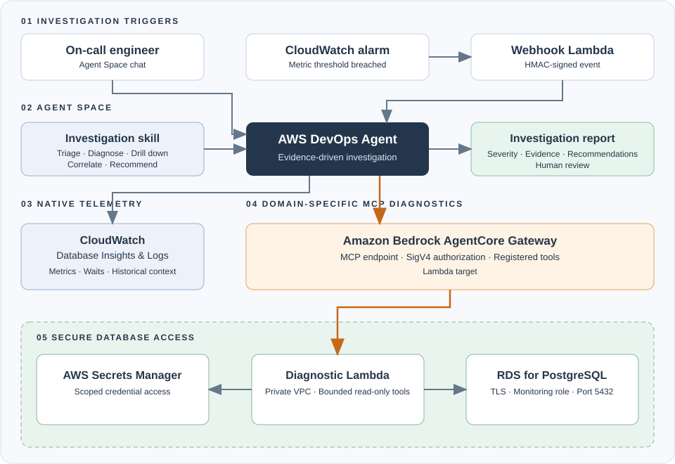

# Agentic PostgreSQL monitoring with AWS DevOps Agent

A reference implementation for investigating Amazon RDS for PostgreSQL operational incidents using AWS DevOps Agent, Amazon Bedrock AgentCore Gateway (MCP), CloudWatch and read-only PostgreSQL diagnostics.

> **Status:** Initial reference implementation. The design includes illustrative examples and an observed non-production high-CPU investigation. Reproducible deployment, automatic webhook initiation, region compatibility and measured costs remain to be validated. This is an independent project, not an official AWS sample.

## Architecture

## What it does

- Triage CPU, connections, memory, latency and database load using native telemetry.
- Inspect activity, waits, blocking relationships and cumulative database statistics using bounded read-only catalog queries.
- Guide incident analysis with a PostgreSQL investigation skill.
- Return evidence and recommendations for human review, without automated remediation.

## Repository layout

| Path | Purpose |
|---|---|
| [docs/](docs/) | Architecture and original article |
| [skills/postgres-investigation/](skills/postgres-investigation/) | Agent skill and tool reference |
| [db-engines/postgresql/](db-engines/postgresql/) | Diagnostic query catalog |
| [deployment/](deployment/) | Deployment and validation guidance |
| [examples/](examples/) | Clearly labeled synthetic reports |
| [tests/](tests/) | Validation checklist |
| [SECURITY.md](SECURITY.md) | Monitoring access boundaries |

## Getting started

1. Review [the architecture article](docs/blog-postgresql.html) and [security boundaries](SECURITY.md).
2. Prepare an authorized non-production RDS PostgreSQL instance and monitoring identity.
3. Follow the [deployment guide](deployment/README.md) to prepare the diagnostic integration.
4. Package the [investigation skill](skills/postgres-investigation/) and configure it in an Agent Space.
5. Complete the [validation checklist](tests/README.md) before any production use.

The query catalog is an illustrative implementation component, not a deployed MCP server. Reviewed diagnostic and webhook Lambda source is included under `deployment/lambda/`. The maintainer's test demonstrated a real high-CPU alarm and user-triggered investigation with three recorded MCP tool invocations. The published revision's reproducible Gateway registration, CloudFormation stacks, dependency packaging and full integration tests remain pending.

## Observed validation

See the [sanitized high-CPU investigation case study](docs/blog-postgresql.html#validated-cpu): CPU reached approximately 100%, two alarms fired, and a manually initiated investigation completed in 5 minutes 19 seconds. The timeline records calls to three PostgreSQL MCP tools. Automatic webhook initiation is not established by this test.

## Reference

Inspired by the organization of [AWS's SQL Server sample](https://github.com/aws-samples/sample-agentic-db-ops-sqlserver). The PostgreSQL design and documentation here are independent.

## Example resource name

Public RDS examples use `pgmonitor-test`, a fictional RDS instance identifier. Configure your own resource identifiers through deployment parameters and secrets; never commit actual credentials or identifiers.
